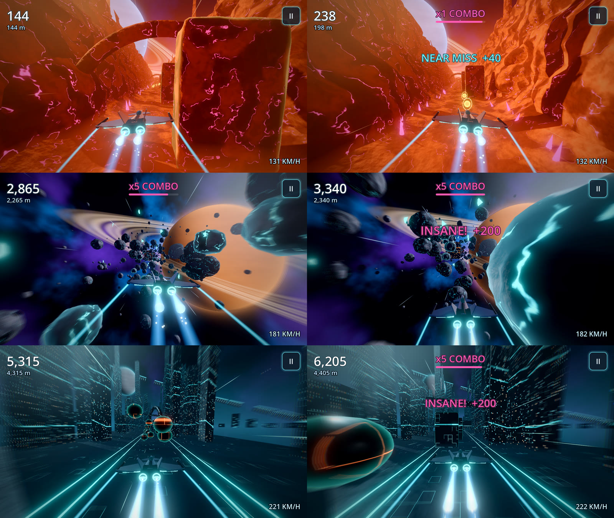

# Void Runner

**High-speed immersive spaceship flying through alien planets, asteroid fields and abandoned civilizations.**
*Hook: experience incredible speed and near misses.*

DashPanda Studios · Android · Godot 4.7.2 (pinned) · typed GDScript · landscape



▶ 24-second gameplay capture: [`media/void_runner_tour.mp4`](media/void_runner_tour.mp4)

## What's in this build (prototype, phases 0–1)

| Area | Status |
|---|---|
| One-thumb relative-drag flight (finger-down = neutral anchor, edge re-anchoring), acceleration-limited `CharacterBody3D`, independent visual bank | ✅ |
| Swept collision (`move_and_collide`) – no tunnelling at 65 m/s / 30 FPS | ✅ tested 100/100 |
| Procedural corridor: 10 authored modules (canyon-left/right, pillar-split, ring, debris gap, beams, slalom, gauntlet, open, recovery) with bounded randomness | ✅ |
| Controller-aware fairness validator: voxelized cross-section, inflated hazards, reachable-cell propagation, retry → safe recovery chunk | ✅ 16,000 chunks certified |
| One continuous certified route per run (drives energy lines + attract-mode autopilot) | ✅ |
| Separate RNG streams (route / hazard / pickup / cosmetic), seed + generator version reproduction | ✅ |
| 3 visual sectors that cross-fade: **Crimson Reach** (alien canyon planet), **Shattered Belt** (asteroid field), **Silent Spires** (abandoned megastructure) | ✅ |
| Scoring contract `floor(distance) + Σ 40 × combo`, combo ≤ 5, 4 s expiry, one payout per obstacle id | ✅ tested |
| Near-miss feedback: popup, combo meter, sparks, FOV kick, hit-stop, whoosh, haptics | ✅ |
| Run state machine MENU → TUTORIAL/COUNTDOWN → RUNNING → CRASHED → RESULTS, PAUSED remembers previous | ✅ tested |
| Pause on focus loss, held touches cleared, UI consumes touches first, 48 dp+ targets, safe-area margins | ✅ |
| Versioned atomic save + backup recovery + reward ledger, 3 liveries (equal collision size) | ✅ tested |
| Settings: reduced motion, invert Y, quality preset (Low/High), haptics, effects volume | ✅ |
| Procedural audio placeholders (engine/wind layers, whoosh, boom, chimes, countdown) | ✅ |
| Ads / billing / consent / telemetry | ⛔ excluded from prototype (per guide) |

Everything visual is generated at runtime – procedural meshes (ship, rocks, asteroids, canyon walls,
towers) and custom shaders (sky with planets/rings/nebula/megastructure, triplanar rock with glowing
veins, ruin panelling with live circuits, engine plumes, ribbon trails, speed post-process). No
third-party assets, so the asset register is clean (`docs/ASSET_REGISTER.md`).

## Run it

1. Install **Godot 4.7.2-stable** (standard build).
2. Open `project.godot` (first open imports the project), press **F5**.

Desktop controls: mouse drag = touch drag (emulated), or **WASD / arrows**. **Space** launches,
**Esc / P** pauses.

## Verify it

```bash
godot --headless --path . --import
```

```bash
godot --headless --path . --script res://tests/run_tests.gd -- --seeds=1000
```

```bash
godot --headless --path . --fixed-fps 60 --script res://tests/flow_smoke.gd
```

```bash
godot --headless --path . --fixed-fps 60 -- --soak=50 --soak-distance=4500
```

```bash
tools/capture.sh captures 1280x720
```

* `run_tests.gd` – scoring, near-miss integrity, state machine, seeded reproduction, reachability
  (N seeds × 4 difficulty bands), bot survival on the certified route, pool cycling, save
  migration/recovery/ledger, swept collision. `--only=reach,bot` runs a subset.
* `flow_smoke.gd` – drives the real main scene with simulated touch through tutorial, pause on focus
  loss, crash, results and retry.
* `--soak=N` – the in-engine physics autopilot (not invulnerable) plays N run/retry cycles and checks
  pools for leaks.
* `capture.sh` – screenshot tour of every sector (uses Xvfb + lavapipe on headless Linux).

Latest results are recorded in `docs/ACCEPTANCE.md`.

## Project layout

```
addons/dashcore/      shared, versionable services (RunSession, InputRouter, NodePool,
                      SeedService, SaveStore, procedural audio)
game/controllers/     FlightController, ChaseCamera, RouteFollower (autopilot)
game/generation/      ObstacleSpec, ModuleLibrary, ReachGrid (fairness), CorridorDirector,
                      WorldDresser / ChunkDressing / ObstacleNode (pooled spawning)
game/data/            typed .tres: HandlingConfig, DifficultyProfile, ThemeProfile ×3,
                      ChunkDefinition
game/art/             MeshFactory, ShipBuilder, GameMaterials, shaders/
game/fx/              SpeedFX, Trail3D, BurstFX, NearMissSensor
game/services/        ScoreService (only thing that turns events into points)
game/ui/              GameUI (menu, HUD, pause, settings, hangar, results)
game/scenes/          main.tscn + run_root.gd (AppRoot/RunRoot, state machine)
tests/ tools/ docs/ media/
```

## Android

See `docs/ANDROID.md` (export preset included, `com.dashpanda.voidrunner`, arm64-v8a, Mobile
renderer). Signing secrets stay out of source control.

## Next (from the development guide)

1. Phase 0 on hardware: install a debug build on the reference phones (4 GB / 6 GB / 8 GB, two GPU
   families), suspend/resume, touch + audio, baseline profiling → `docs/DEVICE_BENCHMARKS.md`.
2. Run the 10-person unfamiliar-player test (gate: ≥8 start unaided, ≥7 understand why they failed,
   ≥6 replay three times). One tuning cycle max if it fails.
3. Only then: vertical slice (phase 2) and the native ads/consent/billing integration spike.
