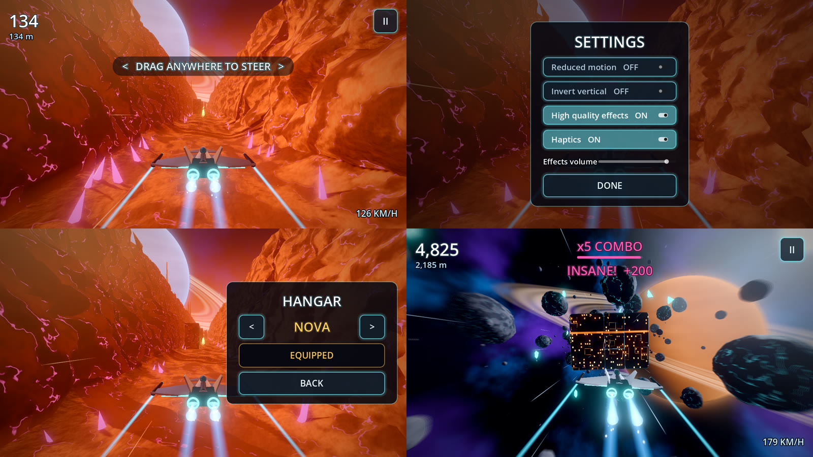
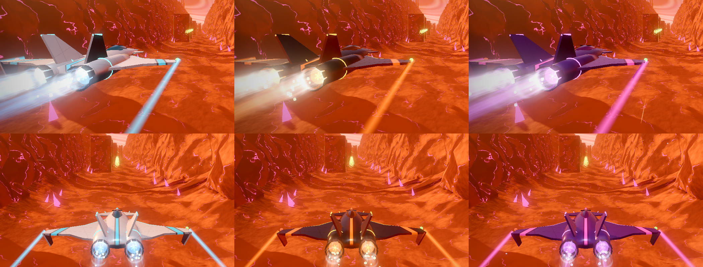
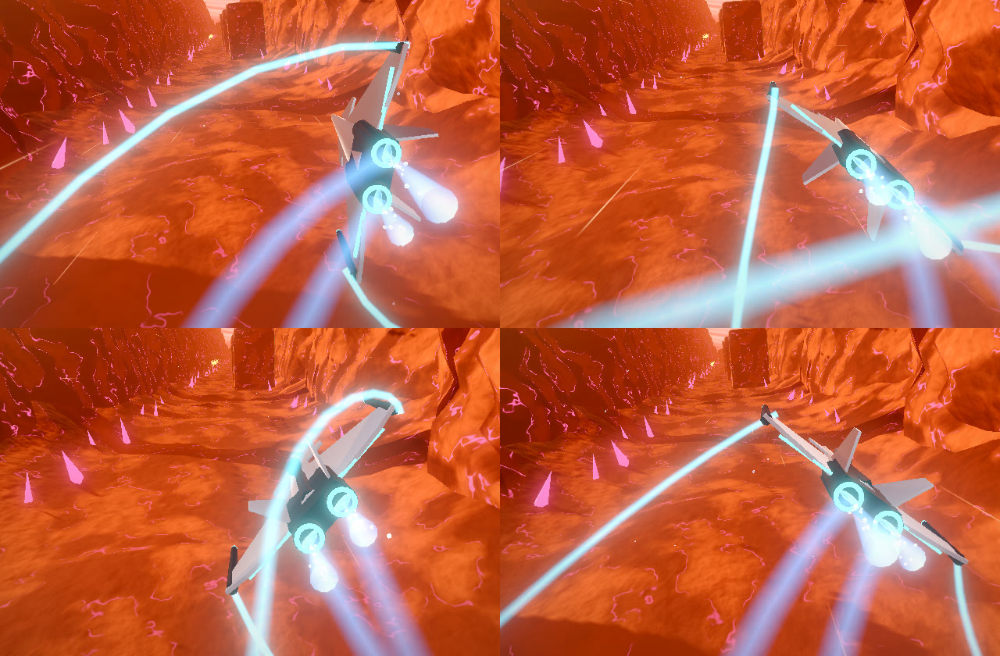
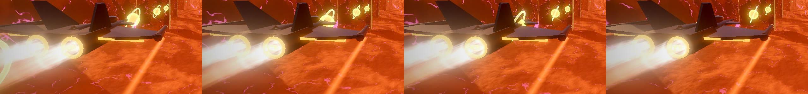
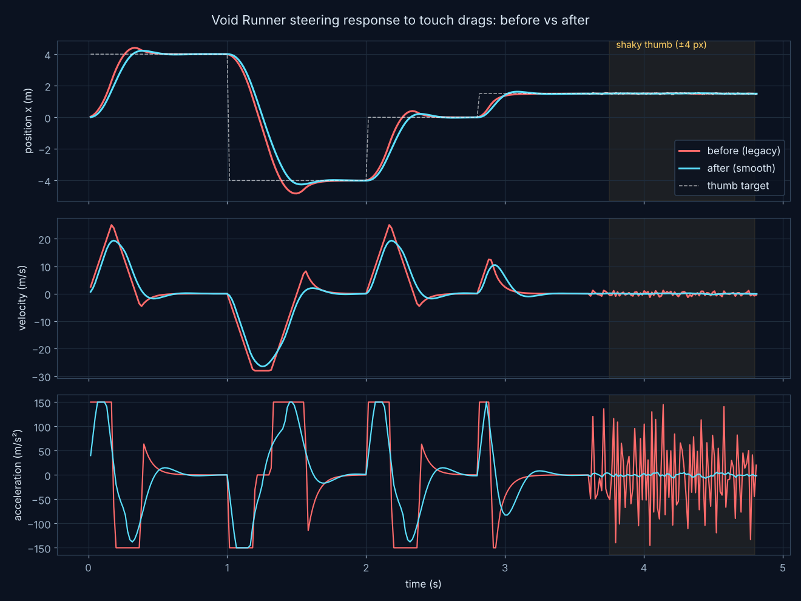

# Void Runner

**High-speed immersive spaceship flying through alien planets, asteroid fields and abandoned civilizations.**
*Hook: experience incredible speed and near misses.*

DashPanda Studios · Android · Godot 4.7.2 (pinned) · typed GDScript · landscape












▶ Same scripted drags, old vs new steering side by side: [`media/steering_before_after.mp4`](media/steering_before_after.mp4)

▶ 24-second gameplay capture: [`media/void_runner_tour.mp4`](media/void_runner_tour.mp4)

## What's in this build (prototype, phases 0–1)

| Area | Status |
|---|---|
| One-thumb relative-drag flight (finger-down = neutral anchor, edge re-anchoring), acceleration-limited `CharacterBody3D`, independent visual bank | ✅ |
| Swept collision (`move_and_collide`) – no tunnelling at 65 m/s / 30 FPS | ✅ tested 100/100 |
| Procedural corridor: 10 authored modules (canyon-left/right, pillar-split, ring, debris gap, beams, slalom, gauntlet, open, recovery) with bounded randomness | ✅ |
| Controller-aware fairness validator: voxelized cross-section, inflated hazards, reachable-cell propagation, retry → safe recovery chunk | ✅ 16,000 chunks certified |
| One continuous certified route per run (drives energy lines + attract-mode autopilot) | ✅ |
| Separate RNG streams (route / hazard / pickup / cosmetic), seed + generator version reproduction | ✅ |
| 3 visual sectors that cross-fade: **Crimson Reach** (alien canyon planet), **Shattered Belt** (asteroid field), **Silent Spires** (abandoned megastructure) | ✅ |
| Scoring contract `floor(distance) + Σ 40 × combo`, combo ≤ 5, 4 s expiry, one payout per obstacle id | ✅ tested |
| Near-miss feedback: popup, combo chevrons, sparks, FOV kick, hit-stop, whoosh, haptics | ✅ |
| Interceptor ship: faceted lofted fuselage with glowing chines, gem-cut canopy, cranked arrow wings with lit leading edges and livery chevrons, anhedral tip fins, swept twin tails, lofted engine pods with intakes; two-tone hull shader with panel lines and spine stripe | ✅ |
| Thrusters: petal nozzles that iris open with throttle, spinning glowing turbines, surge heat rings, wingtip RCS jets that fire on lateral acceleration, red/green nav lights and a double-flash strobe | ✅ |
| Fluid engine plume: swept plume mesh + flow shader (turbulence streaming back, travelling-wave undulation, breathing radius, shock diamonds, white-hot→livery gradient), soft heat sheath, tail that lags lateral motion (spring), eased length, thrust surges on launch / roll / near miss | ✅ |
| Smooth steering: adaptive touch filter, eased braking-curve arrival, jerk-limited acceleration (RMS jerk 6× lower, shaky-thumb jitter 6× lower, overshoot halved vs legacy); spring camera with turn lead, noise-based shake, springy FOV; eased hit-stop / slow-mo | ✅ measured with `--trace-steer` |
| Ship motion: spring-driven bank with anticipation and overshoot, yaw into turns, pitch, idle hover, differential engine flare, wingtip vapour that brightens in hard banks | ✅ |
| Barrel roll left/right (thumb buttons, Q/E): 360 deg roll + sidestep, cooldown ring, "ROLL DODGE!" near misses | ✅ autotest stage `roll` |
| UI kit: cut-corner glass panels, skewed buttons, letter-spaced type, segmented speed gauge, drawn switches, results cards with count-up, screen transitions, hangar showcase camera | ✅ |
| Run state machine MENU → TUTORIAL/COUNTDOWN → RUNNING → CRASHED → RESULTS, PAUSED remembers previous | ✅ tested |
| Pause on focus loss, held touches cleared, UI consumes touches first, 48 dp+ targets, safe-area margins | ✅ |
| Versioned atomic save + backup recovery + reward ledger, 3 liveries (equal collision size) | ✅ tested |
| Settings: reduced motion, invert Y, quality preset (Low/High), haptics, effects volume | ✅ |
| Procedural audio placeholders (engine/wind layers, whoosh, boom, chimes, countdown) | ✅ |
| Ads / billing / consent / telemetry | ⛔ excluded from prototype (per guide) |

Everything visual is generated at runtime – procedural meshes (ship, rocks, asteroids, canyon walls,
towers) and custom shaders (sky with planets/rings/nebula/megastructure, triplanar rock with glowing
veins, ruin panelling with live circuits, engine plumes, ribbon trails, speed post-process). No
third-party assets, so the asset register is clean (`docs/ASSET_REGISTER.md`).

## Run it

1. Install **Godot 4.7.2-stable** (standard build).
2. Open `project.godot` (first open imports the project), press **F5**.

Touch: drag anywhere to steer; tap the **ROLL** thumb buttons (bottom corners) for a barrel roll -
a 360 deg dodge that sidesteps ~4.5 m (0.9 s cooldown; works as a second finger while steering).
Desktop: mouse drag = touch drag (emulated), or **WASD / arrows**; **Q / E** barrel roll left / right;
**Space** launches; **Esc / P** (Android back) pauses and resumes.

## Verify it (no screen needed)

Every check runs headless or on a virtual screen (Xvfb + software rendering), so an AI agent or
CI box without a GPU can build, play and look at the game. Engine binary: set `GODOT=/path/to/godot`
(keep it outside the repo).

```bash
godot --headless --path . --import
```

```bash
godot --headless --path . -- --fresh --autotest
```

```bash
godot --headless --path . --script res://tests/run_tests.gd -- --seeds=1000
```

```bash
godot --headless --path . --fixed-fps 60 --script res://tests/flow_smoke.gd
```

```bash
godot --headless --path . --script res://tests/audio_check.gd
```

```bash
godot --headless --path . -- --soak=50 --soak-distance=6500
```

```bash
tools/shot.sh /tmp/hud.png 1280x720 mobile --state=hud --distance=2300
```

```bash
tools/capture.sh captures 1280x720 mobile
```

```bash
tools/x11_flow.sh /tmp/x11_flow
```

| Check | What it proves |
|---|---|
| `--autotest` | Plays the whole game: real UI clicks (tap to launch, pause, resume, roll button, hangar, settings), a real touch drag, a Q-key roll, Esc pause/resume, autopilot flight with collisions **on** through every difficulty band and all three sectors to top speed, a crash, the results/reward ledger, a livery purchase (refusal + success) and a retry. One `[autotest] stage=…` line per stage; exit code 0/1 |
| `run_tests.gd` | Scoring, near-miss integrity, state machine, seeded reproduction, reachability (N seeds × 4 bands), bot survival on the certified route (4 bands + 65 m/s), pool cycling, save migration/recovery/ledger, swept collision |
| `flow_smoke.gd` | Real main scene with simulated touch: tutorial, focus-loss pause, crash, results, retry |
| `audio_check.gd` | Every synthesized sound is finite, unclipped, audible, loops are seamless; master limiter present |
| `--soak=N` | N run/retry cycles flown by the physics autopilot (not invulnerable); pool leak check |
| `shot.sh` / `capture.sh` | Screenshots of any state on Mobile (Vulkan/lavapipe) or Compatibility (`compat`, OpenGL) |
| `x11_flow.sh` | The flow driven from **outside** the engine with real X11 mouse/keyboard (`xdotool`) and `import -window root` grabs |

Video with audio (Movie Maker), then measure the audio because nobody is listening:

```bash
xvfb-run -a -s "-screen 0 1280x720x24" godot --path . --resolution 1280x720 --write-movie /tmp/tour.avi --fixed-fps 30 -- --fresh --shots=/tmp/tour_frames
```

```bash
ffmpeg -i /tmp/tour.avi -af volumedetect -vn -f null -
```

### Dev flags (passed after `--`, read by `game/dev/dev_harness.gd`)

| Flag | Effect |
|---|---|
| `--fresh` | Throw-away save, deleted on exit (implied by `--autotest`, `--shot(s)`, `--state`, `--soak`) |
| `--save=PATH` | Use this save file (save → reload checks) |
| `--autotest` | Automated playthrough described above |
| `--until=N\|NAME` | Stop the autotest after a stage: `boot launch steer roll running band1 pause band2 sector2 band3 sector3 loop crash results hangar settings retry` |
| `--no-warp` | Autotest flies every metre (default fast-forwards between stages, flying the last 450 m for real) |
| `--shot=PATH` | Save a viewport screenshot, then quit (after `--state` or `--until`) |
| `--shots=DIR` | Timeline tour: menu, three sectors, crash, results (alias `--capture=DIR`) |
| `--state=NAME` | `menu tutorial countdown hud pause settings hangar results roll bank` (`--roll-at=0..1`, `--roll-dir=-1\|1` for roll) |
| `--distance=M` | Start runs at this route distance (sector / difficulty) |
| `--seed=N` | Deterministic run seeds |
| `--livery=ID` | `nova ember phantom` |
| `--quality=low\|high`, `--reduced-motion`, `--invert-y` | Settings overrides (in-memory with `--fresh`) |
| `--autopilot` | Runs flown by the route follower (invulnerable) |
| `--soak=N`, `--soak-distance=M` | Soak test |
| `--trace-steer=CSV` | Scripted touch drags (steps + shaky hold) logged per physics frame: t, target, filtered target, x, vx, ax |
| `--legacy-steer` | Use the old (non-smoothed) steering response, for comparisons |
| `--brake_factor= --steer_jerk= --steer_response= --input_smooth_min= --input_smooth_max=` | Override smoothing tuning without rebuilding |

Latest results are recorded in `docs/ACCEPTANCE.md`; what this setup cannot verify is in
`docs/MANUAL_TEST_PLAN.md`.

## Project layout

```
addons/dashcore/      shared, versionable services (RunSession, InputRouter, NodePool,
                      SeedService, SaveStore, procedural audio)
game/controllers/     FlightController, ChaseCamera, RouteFollower (autopilot)
game/generation/      ObstacleSpec, ModuleLibrary, ReachGrid (fairness), CorridorDirector,
                      WorldDresser / ChunkDressing / ObstacleNode (pooled spawning)
game/data/            typed .tres: HandlingConfig, DifficultyProfile, ThemeProfile ×3,
                      ChunkDefinition
game/art/             MeshFactory, ShipBuilder, GameMaterials, shaders/
game/fx/              SpeedFX, Trail3D, BurstFX, NearMissSensor
game/services/        ScoreService (only thing that turns events into points)
game/ui/              GameUI (menu, HUD, pause, settings, hangar, results)
game/dev/             DevHarness: command-line test flags (autotest, shots, soak)
game/scenes/          main.tscn + run_root.gd (AppRoot/RunRoot, state machine)
tests/ tools/ docs/ media/
```

## Android

See `docs/ANDROID.md` (export preset included, `com.dashpanda.voidrunner`, arm64-v8a, Mobile
renderer). Signing secrets stay out of source control.

## Next (from the development guide)

1. Phase 0 on hardware: install a debug build on the reference phones (4 GB / 6 GB / 8 GB, two GPU
   families), suspend/resume, touch + audio, baseline profiling → `docs/DEVICE_BENCHMARKS.md`.
2. Run the 10-person unfamiliar-player test (gate: ≥8 start unaided, ≥7 understand why they failed,
   ≥6 replay three times). One tuning cycle max if it fails.
3. Only then: vertical slice (phase 2) and the native ads/consent/billing integration spike.
